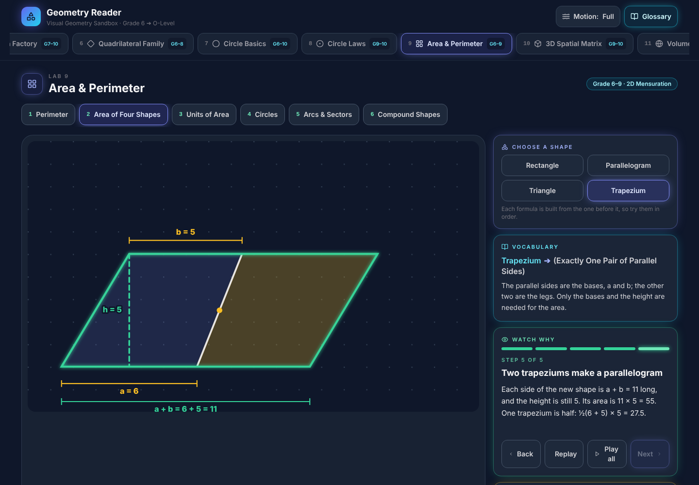
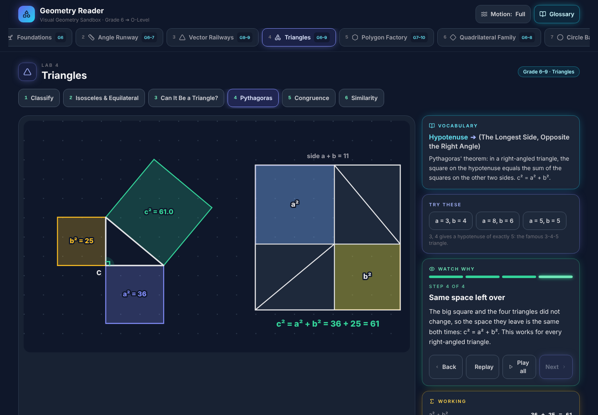
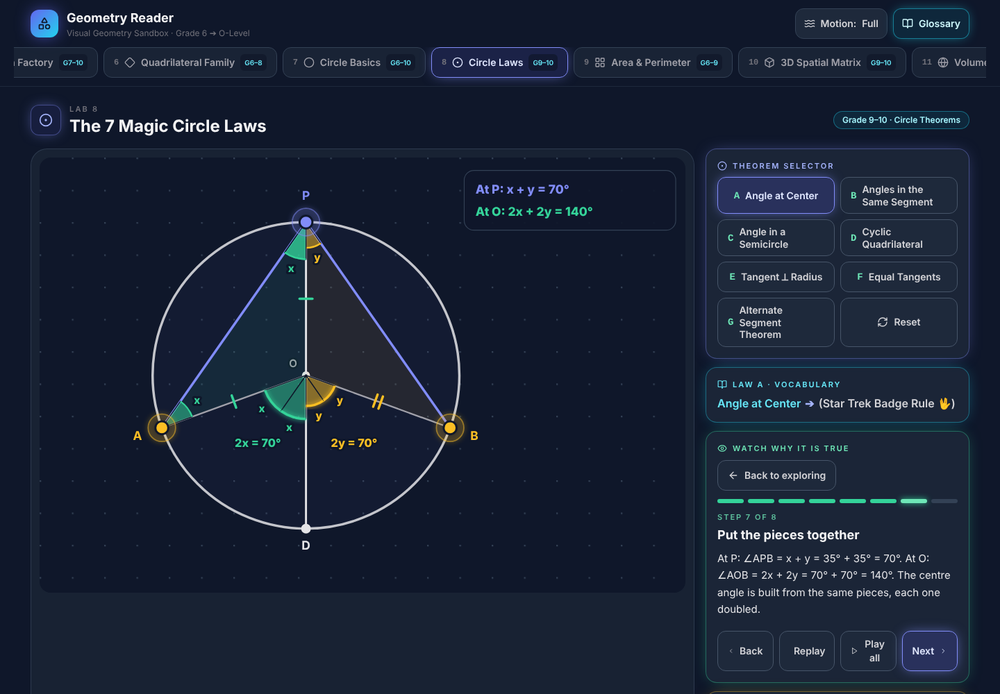
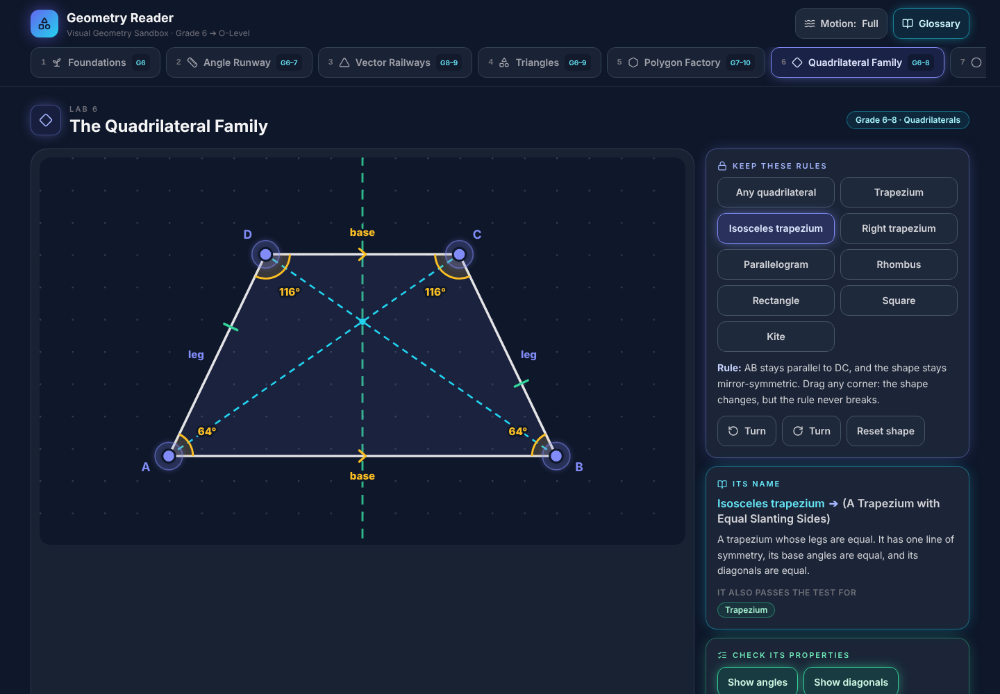
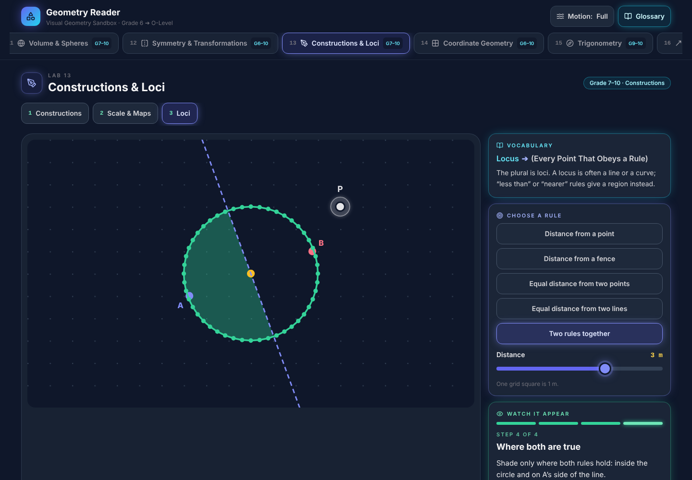
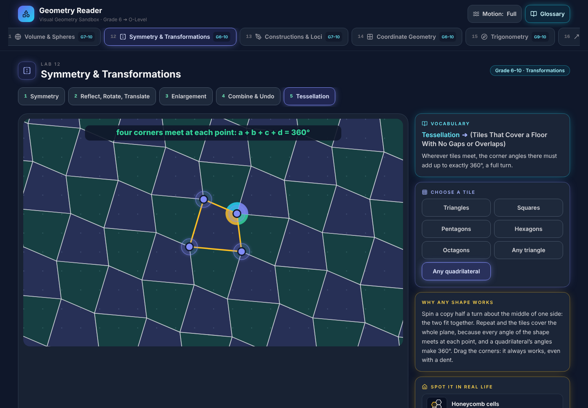
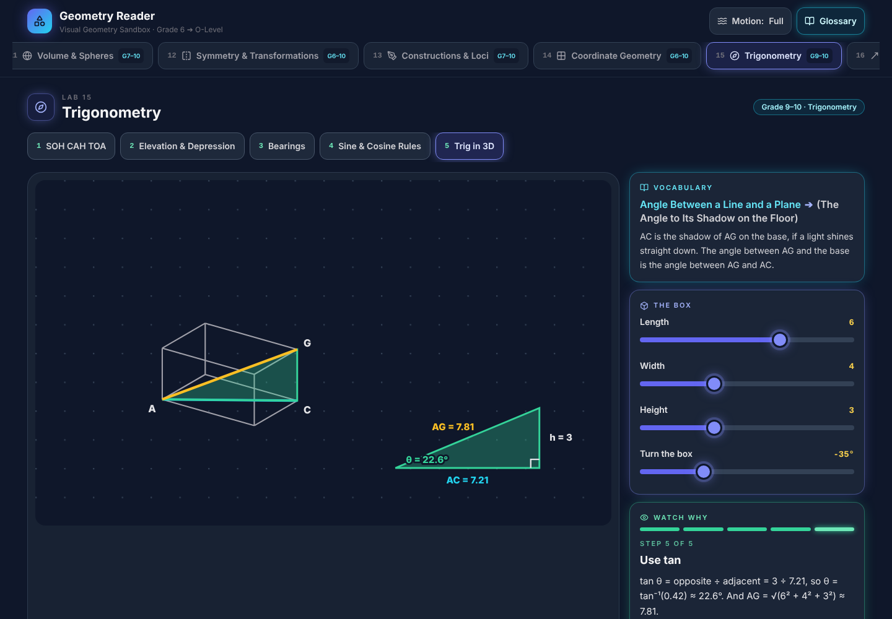

# Geometry Reader

**Geometry you can see, touch and watch being proved.** Built for the learners with the least access: girls studying mathematics on shared household phones in regional Bangladesh.

**[Open the live demo →](https://sciencereaders.github.io/geometryreader/)** · A Science Readers module · Working prototype, in use in the author's own teaching; not yet formally evaluated

## Why it exists
In Bangladesh, mathematical "merit" follows access. The best tutoring is concentrated in the capital, among families who can pay for it. At the margin, access is gendered as well: a girl's time on the family phone is often rationed, supervised and costed against everything else the household needs. Geometry Reader is designed for those conditions. It puts a visual, hands-on geometry resource within reach of any learner with a browser, and asks little of the household: one small download, no account and no further data.

## Where it fits in learning
Geometry Reader is not a textbook and not a replacement for practice. It is designed for the step between them.
- **The textbook states the result.** For example: the angle at the centre is twice the angle at the circumference.
- **Practice builds fluency** in using it.
- **What is usually missing is the reason.** A good tutor supplies it by drawing, redrawing and explaining until the learner sees why. Families who can pay for tutoring buy that step; most learners at the margin go without it.

Geometry Reader supplies the missing step. The learner moves the figure, sees which facts survive every change, and watches the proof happen. In the author's teaching it is the second explanation, not the first: lessons start with the textbook and the methods learners are used to, the tool comes in where confusion remains, and practice follows without it. Whether it improves understanding is a research question, not yet a finding.

## What makes it different
- **Watch why, not just that.** Every theorem and formula is proved by animating the learner's own figure. Pieces fold, swing and slide until the reason is visible.
- **Manipulate first.** Learners drag points, lines and solids; every angle, length, area and volume updates live.
- **Formal and plain language together.** Every exam term sits beside a plain-language translation.
- **A calm interface.** One tap switches off all motion and flashes; drag targets are large and forgiving; everything works from the keyboard.
- **Built for constrained devices:**
  - About 200 KB to download, once.
  - After that, no data is sent or received, and it keeps working offline once loaded. An installable offline version is planned.
- **Nothing to watch over.** No login, no profile, no tracking. On a shared phone, it keeps no record of the learner.
- **Rooted in learners' own world.** Every idea is anchored in everyday objects, drawn in-house: a carrom board, a paper kite, a roti.

## How it is being developed
Geometry Reader is built and used at the same time. The learning sciences call this **design-based research**: a tool is designed for real classrooms, used there, observed and revised, so that each round improves both the tool and the understanding of how learners learn with it.
- **Now, in practice:** the tool is used in the author's own teaching and revised from what is observed, including whether a figure makes an idea clear at first sight. Changes are recorded in a practitioner's design journal. Nothing about any learner is published, and no findings are claimed.
- **Next, a formal study:** an evaluation with ethical approval, parental consent and each student's own assent, testing the hypotheses set out in [RESEARCH.md](RESEARCH.md).

## Coverage
Sixteen interactive labs span school geometry from the first idea of a point to secondary-school trigonometry and vectors. Highlights:
- Pythagoras' theorem proved by rearrangement.
- Congruence shown by rebuilding a triangle from only the facts given.
- Circle theorems, and every area and volume formula derived on screen.
- Loci, transformations, coordinate geometry and trigonometry.

<table>
  <tr>
    <td></td>
    <td></td>
  </tr>
  <tr>
    <td></td>
    <td></td>
  </tr>
  <tr>
    <td></td>
    <td></td>
  </tr>
</table>

## Science Readers
Geometry Reader is the flagship module of **Science Readers**, a private educational ecosystem planned to extend the same approach to localised modules in Mathematics, Physics, Chemistry and Biology. See [CURRICULUM.md](CURRICULUM.md).

## Read more
| Document | Contents |
|---|---|
| [RESEARCH.md](RESEARCH.md) | Research statement: the problem, where the tool sits in learning, research questions, approach and references |
| [DECISIONS.md](DECISIONS.md) | The human-centred design principles behind the tool |
| [STORY.md](STORY.md) | Why the project exists |
| [AI_USE.md](AI_USE.md) | Authorship, the author's contribution, and AI use |
| [LICENSE](LICENSE) | Proprietary licence |

## About the author
**Wasema Farzana** builds learning tools for the learners with the least access to them. Three kinds of experience shape Geometry Reader:
- **Five years of teaching, from preschool to O-Level.** This is where the pedagogy comes from: ideas handled before they are named, and proofs watched rather than recited.
- **Work in Bangladesh's development sector.** This is where the design constraints come from: shared phones, rationed data, and study time that someone else can check.
- **An anthropological approach to technology.** A device is treated as part of a household, with its own economics and politics, not as a neutral tool.

The work sits at the intersection of HCI, education and the anthropology of technology.

For research, collaboration or licensing enquiries, contact the author through [GitHub](https://github.com/wasemafarzana1).

## Licence
Copyright © 2026 Wasema Farzana. All rights reserved. This is not open-source software. No part of it may be used, copied, modified, distributed or sold without written permission. See [LICENSE](LICENSE).

---

**Note for Reviewers:** Implementation details, the full design decision log, the topic-by-topic curriculum map and the research instruments are withheld from this public page. The full Reviewer Pack, including an author contribution statement, is available to admissions committees and academic labs on request.
